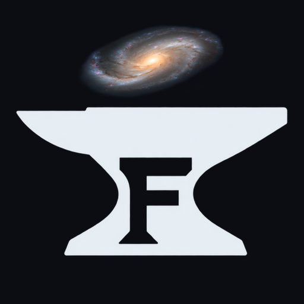

  

<h1 align="center">Ferrebar</h1>

  <b>The rebar your game is cast around.</b> 
  A framework, not an engine, for building games and engines in
  <a href="https://github.com/ferron-lang">Ferron</a>.

---

Ferrebar is to Ferron what [BRUTAL](https://github.com/ahwootech/BRUTAL) is
to C#: a small set of libraries a game stands on, and nothing it has to
live inside. There is no editor, no scene graph, and no renderer. Your
game owns its loop, its threads, and its data.

## Principles

- **A framework, not an engine.** Ferrebar gives you the steel; the shape
  of the building is yours. Each game decides where precision matters, how
  it simulates, and how it draws.
- **C at C cost.** Bindings are generated from C headers with
  `anvil ffi gen`, and every C layout is checked against clang's at
  compile time. Vulkan, physics, fonts, and audio are one `extern "C"`
  call away.
- **No collector to fight.** Ferron frees memory deterministically, with
  no tracing GC. GPU objects are affine resources: each closes exactly
  once, in order, and a leak shows up as a live handle.
- **Threads without data races.** Windowing on `main`, a pinned render
  actor, a simulation actor at its own rate, and mapped GPU memory split
  into disjoint parts that workers fill in parallel.
- **Take what you need.** One package per library, each with its own
  repository and version, so a game pulls in only what it uses.
- **Built by shipping.** A library joins Ferrebar when a real game needs
  it, not before.

## Packages

| Area | Package | Over | Status |
|---|---|---|---|
| Windowing and input | [`ferron-lang/glfw`](https://github.com/ferron-lang) | GLFW 3 | in Ferron's org |
| Graphics | [`ferron-lang/vulkan`](https://github.com/ferron-lang) | Vulkan 1.4 | in Ferron's org |
| Graphics | `vkx` | staging uploads, sub-allocators, descriptor pools, pipeline presets | planned |
| Graphics | `vma`, `shaderc` | VMA, shaderc | planned |
| UI | `ui` | our own UI in pure Ferron: draw list, Vulkan renderer, text, layout, widgets | planned |
| Text | [`freetype`](https://github.com/ferrebar/freetype) | FreeType 2 | **v0.1.0** |
| Assets | `gltf`, `ktx` | glTF 2.0 in pure Ferron, libktx | planned |
| Physics | `box2d`, `jolt` | Box2D v3, Jolt via a C wrapper | planned |
| Audio | `miniaudio` | miniaudio | planned |
| Diagnostics | `renderdoc`, `tracy` | RenderDoc, Tracy | planned |

Plain bindings that any Ferron program can use live in
[ferron-lang](https://github.com/ferron-lang); Ferrebar holds what a game
needs on top of them.

## Status

Early. Ferron is in alpha and in the middle of self-hosting, and the
packages above are being built in the order two reference games need
them: a 3D physics sandbox and a space base-building game whose players
script their stations in Ferron.

---

Ferrebar shares no code with BRUTAL. BRUTAL is © Ahwoo Limited under
the BRUTAL License v1.0.
